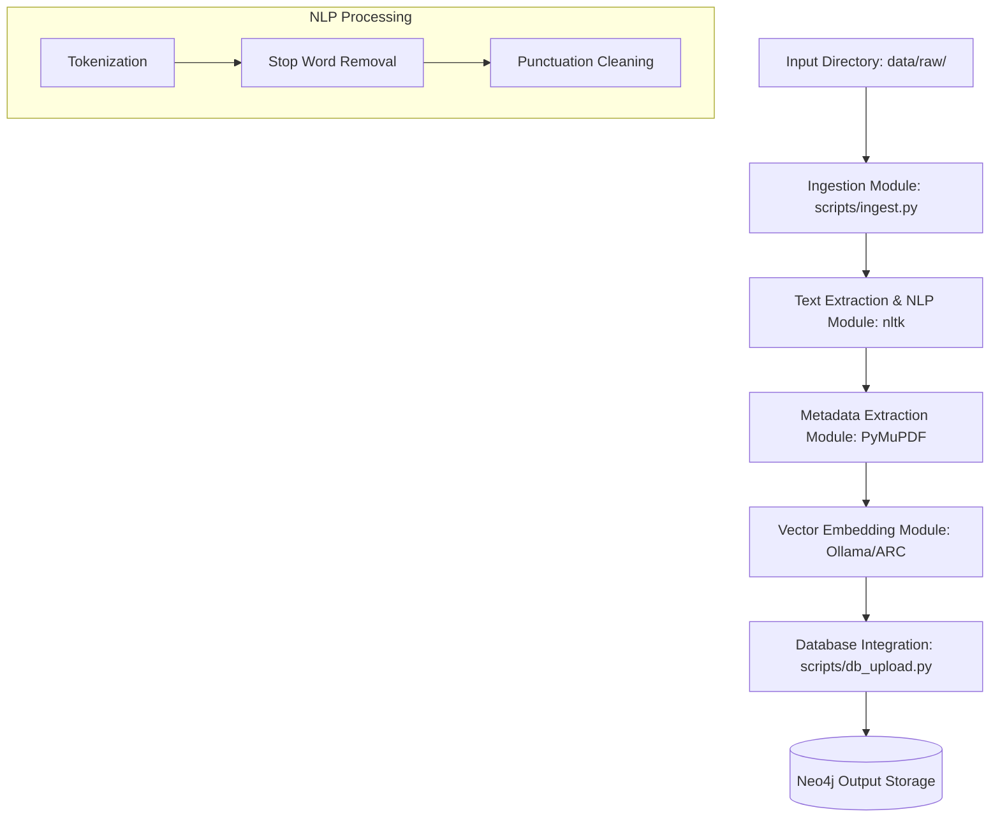

# Milestone M02 - Data Pipeline & CI/CD Setup
**Team Zelkova: Peachtree Pantry & Beverage Co. (PPB) DAIS**

## 1. Requirement Fulfillment Status

| Requirement | Status | Implementation Detail |
| :--- | :--- | :--- |
| **PDF & Text Support** | COMPLETED | `scripts/ingest.py` handles `.pdf`, `.txt`, and `.json`. |
| **Metadata Extraction** | COMPLETED | Internal PDF properties (Author, Title, Date) extracted via PyMuPDF. |
| **NLP Tokenization** | COMPLETED | Implemented via `nltk` (word_tokenize) in `scripts/ingest.py`. |
| **Stop Word Removal** | COMPLETED | Implemented via `nltk.corpus.stopwords` in the cleaning layer. |
| **Vector Embeddings** | COMPLETED | Generated using `nomic-embed-text` via Ollama ARC Cloud. |
| **Neo4j Integration** | COMPLETED | Full metadata persistence on `Document` nodes and `Chunk` relationships. |
| **Containerization** | COMPLETED | Entire stack (App + Neo4j) managed via `docker-compose.yml`. |

---

## 2. Architecture Diagram



---

## 3. Implementation Notes

### NLP & Tokenization
As required by the M02 rubric, we have integrated the **NLTK** library. Every document chunk now undergoes a cleaning pipeline that converts text to lowercase, tokenizes it into individual words, and removes English stop words and punctuation. 

### Metadata Extraction
We have enhanced metadata extraction beyond filenames. Our pipeline now queries the internal dictionary of PDF documents to retrieve the **Author**, **Title**, and **Creation Date**. This data is stored in the intermediate `data/processed/*.json` files and then persisted as properties on the `Document` nodes in Neo4j.

### Containerization (Evaluator Note)
The DAIS system is fully containerized. 
- **Application**: The Python pipeline and agentic framework run within the `ppb-pipeline` container.
- **Database**: Neo4j runs as a dedicated service (`ppb-neo4j`) defined in `docker-compose.yml`.
- **Connectivity**: Containers communicate over a private Docker network using service aliases.

---

## 4. How to Run & Validate

1. **Build & Start Services**:
   ```bash
   docker-compose up --build -d
   ```
2. **Run Pipeline**:
   ```bash
   docker-compose run app python scripts/run_data_pipeline.py
   ```
3. **Verify via Tests**:
   ```bash
   docker-compose run app python tests/test_data_pipeline.py
   ```
