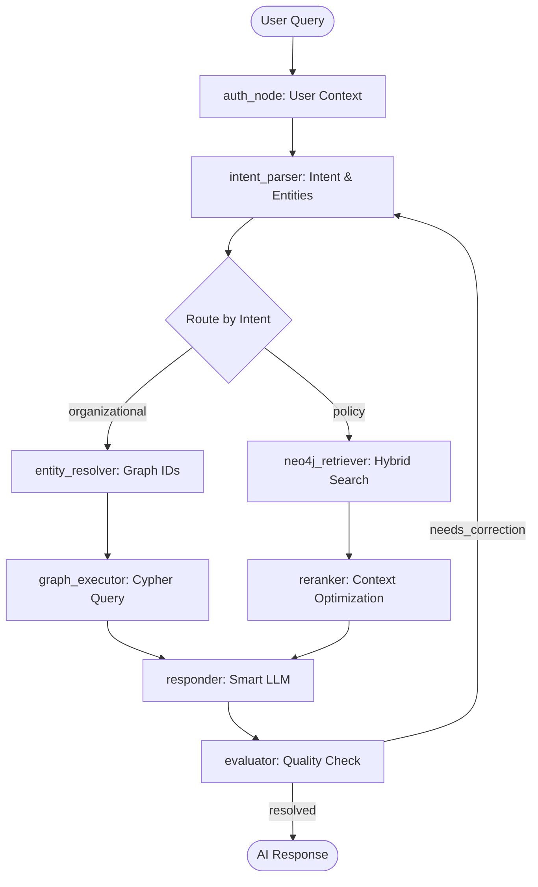

# Milestone M03 - AURORA Agentic Prototype
**Team Zelkova: Peachtree Pantry & Beverage Co. (PPB) DAIS**

## 1. Requirement Fulfillment Status

| Requirement | Status | Implementation Detail |
| :--- | :--- | :--- |
| **AURORA Prototype** | COMPLETED | End-to-end RAG system (Automated User Response & Organizational Resource Agent) integrated via `scripts/agent.py`. |
| **Multi-Agent Pipeline** | COMPLETED | State-based orchestration using **LangGraph** for intent-based routing. |
| **Hybrid Retrieval** | COMPLETED | Combines Neo4j Vector Index (768d) with Full-Text Cypher search. |
| **Entity Resolution** | COMPLETED | Deterministic and LLM-based entity matching for employee records. |
| **Human Interface (Chat)** | COMPLETED | Modern Streamlit UI (`app.py`) with Glassmorphism and context awareness. |
| **Batch Query Interface** | COMPLETED | Evaluation suite (`scripts/dais_retrieval_eval.py`) for automated testing. |

---

## 2. Architecture Diagram (Neural Workflow)



---

## 3. Implementation Notes

### LangGraph Orchestration
The prototype transitions from a linear script to a **state-aware graph**. Each node (Auth, Intent, Resolver, etc.) operates on a unified `ChatState`, allowing for complex conditional routing. For example, queries about personnel are routed through a graph-traversal path, while policy questions trigger a vector-search path.

### Hybrid Fused Context
To improve retrieval accuracy, we implemented a hybrid search strategy in the `neo4j_retriever` node. It executes both a **Vector Search** (for semantic similarity) and a **Full-Text Index Search** (for keyword precision), merging the results using a Reciprocal Rank Fusion (RRF) approach before passing them to the Reranker.

### Streamlit "Intelligence Hub"
The human-facing interface (`app.py`) provides more than just chat:
- **Intelligence Hub**: The primary conversational interface.
- **Entity Registry**: Allows direct graph lookups for employee data.
- **Knowledge Assets**: Visualizes the current ingestion status and database statistics.
- **Core Diagnostics**: Provides transparency into the agent's internal state and connection status.

---

## 4. How to Run & Validate

1. **Launch the Prototype**:
   ```bash
   # Run the Streamlit Chat Interface
   docker-compose up --build
   ```
2. **Execute Batch Evaluation**:
   ```bash
   # Run the retrieval evaluation suite
   docker-compose run app python scripts/dais_retrieval_eval.py
   ```
3. **Verify Agent Logic**:
   ```bash
   # Test individual agent components
   docker-compose run app python tests/test_agent.py
   ```
