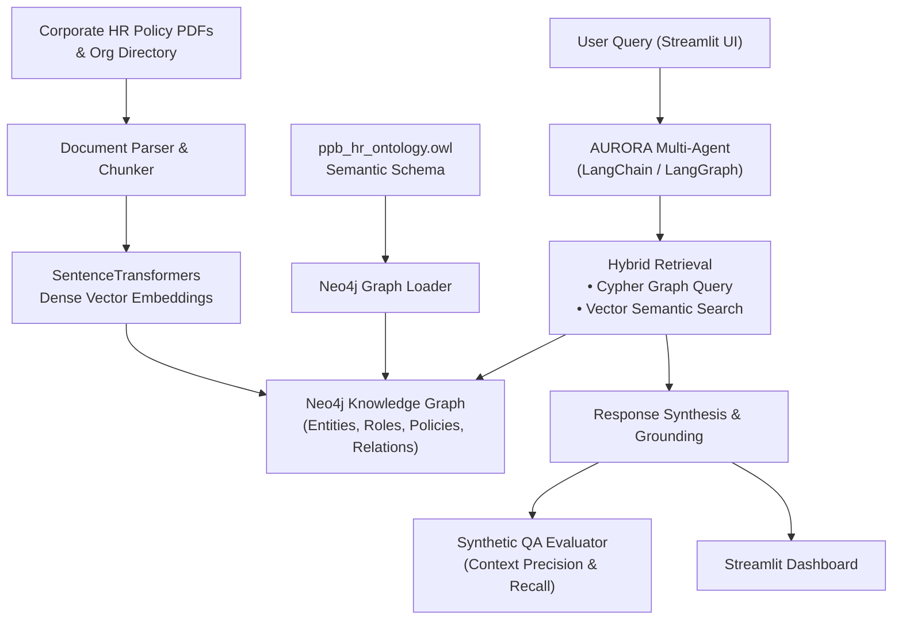

# Peachtree Pantry & Beverage Co. (PPB) - AURORA Enterprise Knowledge Graph & Multi-Agent System


AURORA is an enterprise-grade **Document-Driven Agentic Intelligence System (DAIS)** built for Peachtree Pantry & Beverage Co. (PPB). It ingests corporate HR policy documentation and organizational charts, maps them into a semantic **Neo4j Property Graph** via an OWL ontology (`ppb_hr_ontology.owl`), and deploys a LangGraph multi-agent RAG workflow with rigorous ground-truth evaluation.



---

## System Capabilities

- **Semantic Ontology Grounding:** Fully structured domain ontology (`data/ppb_hr_ontology.owl`) capturing company hierarchy, departments, compliance guidelines, and HR benefits.
- **Automated Graph Ingestion (`scripts/`):**
  - `transform_to_graph.py`: Extracts structured entities, relationships, and taxonomies from raw documents.
  - `embed.py`: Generates dense vector embeddings using SentenceTransformers for hybrid vector+graph search.
  - `load_ppb_graph.py`: Bulk loads nodes and edges directly into Neo4j with relationship validation.
- **Multi-Agent Orchestration (`app.py`):**
  - Interactive Streamlit application with query decomposition, Cypher generation, and response grounding.
- **Rigorous Evaluation Framework:**
  - Automated synthetic question-answer generation (`generate_synthetic_qa_v2.py`) and retrieval evaluation (`evaluate_retrieval.py`).
- **Complete Containerization:**
  - `docker-compose.yml` pre-configured for Neo4j with APOC plugins, vector search indexes, and application services.

---

## Quickstart

```bash
# 1. Configure environment
cp .env.example .env
# Edit .env with your credentials

# 2. Launch Neo4j and services
docker-compose up -d

# 3. Ingest documents and build knowledge graph
python scripts/ingest.py
python scripts/embed.py
python scripts/load_ppb_graph.py

# 4. Launch Streamlit interface
streamlit run app.py
```
